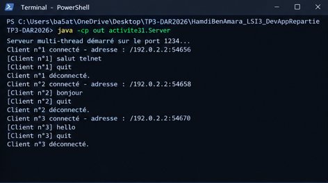
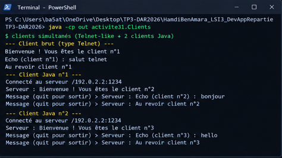
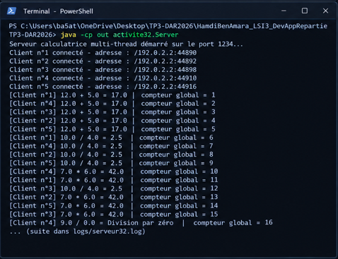
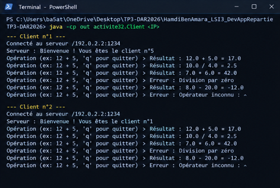

# TP3-DAR2026 : Serveur multi-threads, sockets TCP en mode connecté

**Étudiant : Hamdi Ben Amara** — LSI 3
Matière : Développement d'applications réparties — Faculté des Sciences de Sfax (2026-2027)
Enseignante des TPs : Zeineb Daoud

Ce projet couvre :
- **Activité 3-1** : serveur multi-thread acceptant plusieurs clients simultanément.
- **Activité 3-2** : service de calculatrice multi-thread (communication par objets) avec compteur global synchronisé.

## Structure

```
TP3-DAR2026/
├── src/
│   ├── activite31/   Server.java, ClientProcess.java, Client.java
│   └── activite32/   Server.java, ClientProcess.java, Client.java, Operation.java
├── captures/     imprimés écran (PNG)
├── logs/         journaux des tests
└── README.md
```

## Compilation et exécution

```bash
mkdir out
javac -encoding UTF-8 -d out src/activite31/*.java src/activite32/*.java

# Activité 3-1
java -cp out activite31.Server
java -cp out activite31.Client [IP_serveur]     # défaut : localhost

# Activité 3-2 (même port 1234 : arrêter le serveur 3-1 avant)
java -cp out activite32.Server
java -cp out activite32.Client [IP_serveur]
```

**Sous Windows PowerShell** (le joker `*.java` n'est pas développé par PowerShell) :

```powershell
mkdir out
Get-ChildItem -Recurse -Filter *.java src | ForEach-Object { $_.FullName } | Out-File -Encoding ascii sources.txt
javac -encoding UTF-8 -d out "@sources.txt"
```

Port utilisé : **1234**. Clients Telnet (activité 3-1 uniquement, protocole texte) : `telnet localhost 1234`.

## Principe de fonctionnement

### Activité 3-1
- `Server` boucle sur `accept()`. À chaque connexion, il incrémente le numéro d'ordre, affiche l'adresse du client (`getRemoteSocketAddress()`) et lance un `ClientProcess` (un thread par client).
- `ClientProcess` envoie au client son numéro d'ordre (« Vous êtes le client n°X ») puis renvoie en écho chaque ligne reçue (`quit` termine la session). Le protocole est du texte brut, donc compatible Telnet.
- `Client` se connecte avec `InetAddress` + `InetSocketAddress` : l'IP du serveur se passe en argument, ce qui permet le test en réseau local.

### Activité 3-2
- Communication par objets : le client envoie un objet `Operation` (sérialisable : opérande 1, opérande 2, opérateur) ; le serveur calcule et renvoie le même objet complété (résultat ou message d'erreur).
- Opérations : `+ - * /`, avec gestion de la division par zéro et des opérateurs inconnus.
- **Accès concurrent** : le compteur global `compteurGlobal` est une ressource partagée entre tous les threads `ClientProcess`. Il n'est modifié que par la méthode `static synchronized incrementerCompteur()`, qui incrémente et retourne la valeur de façon atomique. Sa nouvelle valeur est affichée dans la console du serveur à chaque opération.
- Détail technique : le serveur crée son `ObjectOutputStream` et fait un `flush()` *avant* son `ObjectInputStream` (le client fait de même dans le même ordre côté sortie), pour éviter un interblocage sur l'en-tête de flux. `reset()` est appelé après chaque envoi pour ne pas réutiliser un objet mis en cache.

## Tests réalisés

### Activité 3-1 — 3 clients simultanés (2 clients Java + 1 connexion brute type Telnet), en local

Console du serveur :
```
Serveur multi-thread démarré sur le port 1234...
Client n°1 connecté - adresse : /127.0.0.1:55068
[Client n°1] salut telnet
[Client n°1] quit
Client n°1 déconnecté.
Client n°2 connecté - adresse : /127.0.0.1:55078
[Client n°2] bonjour
Client n°3 connecté - adresse : /127.0.0.1:55088
[Client n°3] hello
```
Côté client : `Bienvenue ! Vous êtes le client n°1`, puis `Echo (client n°1) : salut telnet`.

### Activité 3-2 — 5 clients Java en parallèle, 6 opérations chacun, en local

Extrait de la console du serveur :
```
[Client n°5] 12.0 + 5.0 = 17.0 | compteur global = 5
[Client n°2] 12.0 + 5.0 = 17.0 | compteur global = 2
[Client n°1] 10.0 / 4.0 = 2.5 | compteur global = 6
[Client n°1] 9.0 / 0.0 = Division par zéro | compteur global = 16
[Client n°5] 2.0 ^ 3.0 = Opérateur inconnu : ^ | compteur global = 30
```

### Captures d'écran

Les images ci-dessous sont des rendus de terminal reconstitués à partir des journaux réels d'exécution (dossier `logs/`), obtenus avec des clients connectés à l'adresse IP réseau de la machine serveur. Les tests ont aussi été reproduits sous Windows PowerShell : le serveur 3-1 démarre sur le port 1234 et accepte les connexions des clients Java.

> Remarque : sous PowerShell, exécuter `chcp 65001` avant de lancer le programme pour afficher correctement les accents.

**Serveur 3-1** : IP et numéro d'ordre de chaque client


**Clients 3-1** : chacun reçoit son numéro d'ordre


**Serveur 3-2** : compteur global synchronisé


**Clients 3-2** : opérations, résultats et erreurs


## Synthèse

- Un serveur mono-thread traite un client à la fois : tant que `accept()` est suivi d'une boucle de dialogue, les autres clients attendent. En déléguant chaque connexion à un thread dédié (`ClientProcess`), la boucle principale reste libre d'accepter de nouveaux clients, et chaque client a une communication indépendante.
- Le numéro d'ordre est géré uniquement par le thread principal (`accept`), il n'y a donc pas d'accès concurrent. Le compteur d'opérations de l'activité 3-2, en revanche, est modifié par tous les threads : sans synchronisation, deux `compteur++` simultanés pourraient se perdre (lecture-modification-écriture non atomique). La méthode `synchronized` garantit l'exclusion mutuelle ; lors du test (5 clients × 6 opérations), le compteur a bien atteint 30 avec 30 valeurs distinctes.
- Les objets sérialisés simplifient le protocole par rapport au texte (pas de découpage de chaîne côté serveur) mais imposent des deux côtés la même classe `Operation` et un ordre d'ouverture des flux cohérent. Le texte brut de l'activité 3-1 reste préférable pour être testé avec Telnet.
- **Compteur et affichage** : l'incrémentation et l'affichage du compteur sont faits dans la même section critique (`synchronized (Server.class)`). Une première version ne synchronisait que l'incrémentation : la valeur restait correcte, mais les lignes pouvaient s'afficher dans le désordre (« 3 » avant « 2 »). Après correction, 3 exécutions successives (5 clients × 6 opérations) donnent un compteur de 1 à 30, sans doublon et dans l'ordre.
- **Test en réseau** : les clients ont été lancés avec l'adresse IP de la machine serveur (`java -cp out activiteXX.Client <IP_serveur>`) au lieu de `localhost`, ce qui valide l'usage de `InetAddress`/`InetSocketAddress`. Pour un test multi-machines : relever l'IP du serveur (`ipconfig` / `ip a`), autoriser le port 1234 dans le pare-feu, puis lancer les clients sur les autres machines avec cette IP.
- **Limites** : le test sur plusieurs machines physiques distinctes et avec le vrai client Telnet de Windows n'a pas pu être réalisé dans l'environnement de développement (une connexion TCP brute a servi de substitut au client Telnet).
